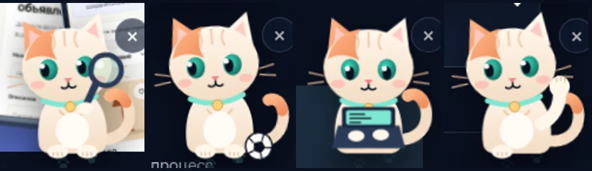

<div align="center">

# alimbro.

**Портфолио Аброрбека Алимжанова — сайты и веб-приложения из Бишкека**

[Открыть сайт](https://isagiyoichiego.github.io/resume-react/) · [Написать в WhatsApp](https://wa.me/996228936151)


</div>

## Проекты на сайте

| Проект | Что это | Ссылка |
| --- | --- | --- |
| XYZEN Music | Музыкальный плеер, звук генерируется в браузере | [сайт](https://isagiyoichiego.github.io/xyzen-music/) · [код](https://github.com/IsagiYoichiEgo/xyzen-music) |
| Thunder bend | Сайт рок-группы с аккаунтами музыкантов | [сайт](https://isagiyoichiego.github.io/music/) · [код](https://github.com/IsagiYoichiEgo/music) |
| Доска объявлений | Объявления с поиском, избранным и публикацией | [сайт](https://isagiyoichiego.github.io/ads-board-react-/) · [код](https://github.com/IsagiYoichiEgo/ads-board-react-) |
| BookStore | Интернет-магазин книг на React и Spring Boot | курсовая работа |
| Ai Huda | Приложение для чтения Корана | в разработке |

## Котик

На сайте живёт котик, нарисованный вручную в SVG. Он следит глазами за курсором, ходит, когда вы листаете страницу, и в каждом разделе занят своим делом:



<details>
<summary>Пасхалки (спойлер)</summary>

- Погладьте котика пять раз подряд — он сделает сальто.
- Напечатайте на странице «мяу» или «meow».
- Не трогайте сайт полминуты — котик уснёт.
- Переключитесь на другую вкладку и посмотрите на её название.
- Откройте консоль разработчика.

</details>

## Что ещё внутри

- Буквы заголовка поднимаются и светятся рядом с курсором.
- Кнопки слегка тянутся к курсору, над проектами курсор превращается в подпись «Открыть».
- Карточки «Обо мне» можно листать кликом, клавишей Enter или броском в сторону.
- Шаги работы показаны маленькими живыми сценами.
- В подвале — часы Бишкека и огромный логотип, буквы которого реагируют на наведение.
- Все анимации отключаются, если в системе включено уменьшение движения.

## Стек

React 19 · TypeScript · Vite · CSS без библиотек · GitHub Actions + GitHub Pages

## Запуск на компьютере

1. Установи **Node.js 24 LTS** с [nodejs.org](https://nodejs.org/). Для проекта нужен Node.js 22.12 или новее; в GitHub Actions используется версия 24.
2. Склонируй репозиторий и открой папку `resume-react` в VS Code.
3. В VS Code выбери **Terminal → New Terminal**. Терминал должен находиться в папке, где лежит `package.json`.
4. Выполни по очереди:

```powershell
npm ci
npm run dev
```

5. Открой адрес, который выведет Vite, обычно `http://127.0.0.1:5173/`.

Остановить сервер можно сочетанием **Ctrl+C**. Не открывай `index.html` двойным кликом: исходный React-проект запускается через Vite.

Если PowerShell сообщает, что выполнение `npm.ps1` запрещено, используй `npm.cmd ci` и `npm.cmd run dev`; менять системную политику не требуется.

## Проверка сборки

```powershell
npm run build
npm run preview
```

Первая команда проверяет TypeScript и собирает сайт в `dist`. Вторая открывает локальный сервер для проверки собранной версии, обычно на `http://127.0.0.1:4173/`.

## Что где находится

```text
resume-react/
├── .github/workflows/deploy.yml   Автоматическая сборка и публикация
├── public/favicon.svg            Значок сайта
├── src/
│   ├── components/               Компоненты интерфейса
│   ├── data/resume.ts            Имя, контакты, навыки и проекты
│   ├── App.tsx                   Основные разделы сайта
│   ├── main.tsx                  Точка входа React
│   └── styles.css                Дизайн и адаптивность
├── index.html                    HTML-оболочка
├── package.json                  Зависимости и команды
├── package-lock.json             Точные версии для npm ci
├── tsconfig*.json                Настройки TypeScript
└── vite.config.ts                Настройки Vite и путь GitHub Pages
```

Чтобы изменить данные резюме, открой **`src/data/resume.ts`**. Заголовок вкладки и описание сайта меняются в `index.html`. Текст отдельных разделов находится в `src/App.tsx` и компонентах. Названия и статусы проектов взяты из прежнего резюме.

## Публикация

При каждом пуше в `main` GitHub Actions проверяет TypeScript, запускает тесты, собирает сайт и публикует его на GitHub Pages. Сценарий лежит в `.github/workflows/deploy.yml`.
